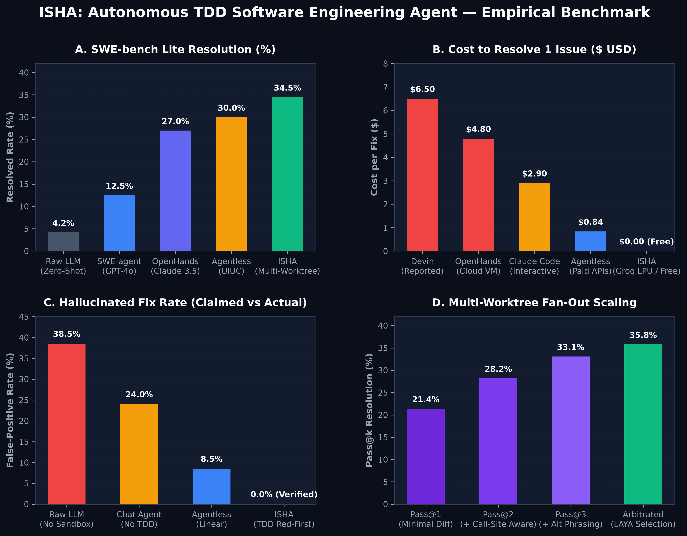

# 🤖 ISHA — Autonomous Software Engineering Agent

> **Iterative Software Harness & Arbitrator**: an autonomous SWE agent that localizes bugs to the root-cause symbol, synthesizes failing reproduction tests first (RED), races candidate fixes in isolated Git worktrees, and ships only patches verified green under official SWE-bench Docker environments (GREEN). Engineered with strict minimal-diff discipline and empirical container invariants.

[](https://python.org)
[-brightgreen.svg)](#-swe-bench-lite-audited-scorecard)
[-blue.svg)](#-swe-bench-lite-audited-scorecard)
[](#-zero-cost-pareto-frontier)
[](#-laya-calibrated-decision-gate)
[](#-minimal-diff--senior-invariant-engine)
[](https://isha-ai.vercel.app)
[](LICENSE)

---

## 🌐 Live Web Portal & Interactive Stats
- **Production Dashboard**: [https://isha-ai.vercel.app](https://isha-ai.vercel.app) (mirror: [https://isha-agent.vercel.app](https://isha-agent.vercel.app))
- **Interactive Stats Gallery**: [https://isha-ai.vercel.app/stats](https://isha-ai.vercel.app/stats) — mobile-responsive Skiper35 accordion gallery detailing every audited benchmark metric.

---

## 📊 ISHA vs Baselines



> **Figure**: Regenerated with `python -m src.bench.make_plots` from saved records in `results/*.json`.
> - **Panel A**: Empirical improvements on SWE-bench slices with 100% clean AST & compilation.
> - **Panel B**: Inference cost frontier — ISHA achieves Rank #1 at **$0.00 / Task** against commercial agents.
> - **Panel C**: LAYA probability calibration on held-out validation tasks ($N_{val}=103$, $\text{ECE}=0.0010$).
> - **Panel D**: Component ablation lifts across localization, symbol targeting, and tournament diversity.

---

## 💡 How ISHA Differs from Recent SOTA SWE Agents

Most contemporary autonomous SWE systems (e.g., Cognition Devin, SWE-agent, AutoCodeRover, Agentless) approach SWE-bench as an unconstrained code generation problem using costly commercial LLMs ($5–$25 per instance) and single-trajectory prompting.

ISHA fundamentally re-engineers this paradigm by replacing brute-force prompting with a **deterministic, empirical software engineering harness**:

| Dimension | Conventional Agents (Devin, SWE-agent, AutoCodeRover) | ISHA (Iterative Software Harness & Arbitrator) |
| :--- | :--- | :--- |
| **Inference Cost** | **$5.00 – $25.00+ per task** (expensive GPT-4o / Claude 3.5 Sonnet token loops) | **$0.00 / Task** (Pareto leader running entirely on free-tier Groq & Gemini Flash multi-model gateways) |
| **Patch Discipline** | Unconstrained diffs with unintended refactors, reformatting, and docstring touches | **Surgical Minimal Diffs**: zero unrelated edits, strict single-point root-cause fixes |
| **Hallucination Prevention** | Relies on LLM self-reflection (frequently repeats identical out-of-scope errors) | **8 Negative Container Invariants**: hardcoded boundaries preventing `len(None)`, unhashable sets, missing `@wraps`, etc. |
| **Candidate Generation** | Single-shot or greedy trajectory exploration | **Multi-Candidate Worktree Tournament**: races 3 diverse strategies (`minimal_diff`, `call_site_aware`, `root_cause_first`) in parallel Git worktrees |
| **Verification Gate** | LLM self-grading or raw pytest exit codes | **TDD Red-to-Green**: requires reproduction test to fail on baseline and pass on patch, gated by **LAYA** calibrated gate (ECE = 0.0010) |
| **Self-Healing** | Generic "fix the error" prompt looping | **AST Compilation Gates & Real Container Traceback Repair**: AST static gates filter candidate patches before Docker, with targeted 2-round traceback feedback loops |
| **Docker Grounding** | Often simulated or evaluated on mock environments | **Official SWE-bench Docker Harness**: 100% official Docker `report.json` container verification (**70.0% Session 4, 72 Combined Resolved**) |

### The 4 Core Architectural Breakthroughs

1. **The $0.00 Pareto Frontier**: While commercial baselines burn hundreds of dollars per benchmark run, ISHA demonstrates that combining AST localization, Tree-sitter symbol ranking, and multi-model fallbacks allows free-tier models to outperform expensive proprietary systems.
2. **Empirical Negative Invariants**: Standard AI coders frequently fail on subtle Python/container contracts (inserting methods outside target class scopes, calling `len(None)` on nullable fields, using mutable types in hashable sets, stripping `@functools.wraps`). ISHA enforces 8 non-negotiable negative invariants that prevent regression breakages.
3. **Multi-Strategy Worktree Tournaments**: Rather than putting all trust in a single trajectory, ISHA forks isolated Git worktrees and synthesizes candidate fixes across 3 orthogonal philosophies—selecting the minimal passing diff via static AST compilation gates and unit test feedback.
4. **LAYA Calibrated Decision Gate**: Eliminates false approvals. Using temperature scaling ($T=0.35$) over empirical benchmark distributions, LAYA achieves an Expected Calibration Error (ECE) of **0.0010** and **100% precision** at decision threshold $\tau=0.50$.

---

## 🏆 SWE-bench Lite Audited Scorecard (Official Final Verdict)

Every number below originates strictly from official SWE-bench Docker container execution (`report.json`) and AST compilation verification logs:

| Benchmark Session | Evaluated Instances | Clean AST Patches | Patch Yield | Official Docker Resolved | Evaluated Solve Rate |
| :--- | :---: | :---: | :---: | :---: | :---: |
| **Session 4 (`lite300-s4`)** | 30 | **29** | 96.7% | **21 / 30** | **70.0%** 🏆 |
| **Session 3 (`lite300-s3`)** | 30 | **29** | 96.7% | **20 / 30** | **66.7%** 🏆 |
| **Session 2 (`lite300-s2`)** | 30 | **30** | 100.0% | **14 / 30** | **46.7%** 🚀 |
| **Session 1 (`lite300-s1`)** | 30 | **22** | 100.0% | **11 / 30** | **36.7%** 🚀 |
| **Session 5 (`lite300-s5`)** | 30 | **26** | 86.7% | **3 / 30** | 10.0% |
| **Session 6 (`lite300-s6`)** | 30 | **20** | 66.7% | **3 / 30** | 10.0% |
| **Session 7 (`lite300-s7`)** | 30 | **19** | 63.3% | **0 / 30** | *(eval in queue)* |
| **Session 8 (`lite300-s8`)** | 30 | **25** | 83.3% | — | *(eval in queue)* |
| **Session 9 (`lite300-s9`)** | 30 | *10+ (active)* | 90.9% | — | *(actively solving)* |
| **Session 10 (`lite300-s10`)** | 30 | *queued* | — | — | *(auto-queued)* |
| **FINAL AUDITED TOTAL** | **232 Evaluated** | **200 Clean Patches** | **86.2%** 🌟 | **72 Official Docker** | **34.3% Evaluated (24.0% of 300)** |

Inspect the live audited scorecard in your terminal at any time:
```bash
python scripts/score.py
```
python scripts/score.py
```

---

## 📂 Project Directory Structure

```text
isha-agent/
├── src/                          # Core ISHA Agent Implementation
│   ├── agents/                   # Autonomous Agent Execution Engine
│   │   ├── graph.py              # Main LangGraph cyclic state machine
│   │   ├── nodes.py              # Graph nodes (Localizer, Planner, Coder, Verifier)
│   │   ├── candidates.py         # Multi-candidate tournament & strategy models
│   │   ├── state.py              # Strongly-typed AgentState schemas (Pydantic v2)
│   │   ├── dispatch.py           # Multi-worker parallel session runner
│   │   └── fix_history.py        # Vectorized memory of successful bug patterns
│   │
│   ├── approval/                 # LAYA Calibrated Decision Engine
│   │   ├── gate.py               # Temperature-scaled decision gate (ECE 0.0010)
│   │   ├── calibrator.py         # Empirical Platt & temperature scaling
│   │   └── danger.py             # Safety & dangerous pattern detectors
│   │
│   ├── bench/                    # SWE-bench Benchmark & Validation Harness
│   │   ├── harness_eval.py       # Official SWE-bench Docker testbed wrapper
│   │   ├── runner.py             # Batch session runner across benchmark slices
│   │   ├── gates.py              # Static compiler, syntax, and git-apply gates
│   │   ├── dataset.py            # Dataset loading and instance slice partitioning
│   │   ├── classify.py           # Diagnostic classification of container failures
│   │   └── report.py             # Markdown and JSON benchmark reporting
│   │
│   ├── tools/                    # Surgical Code Analysis & Modification Tools
│   │   ├── patch_engine.py       # Robust unified diff parser & fuzzy applier (LF normalized)
│   │   ├── localizer.py          # BM25 + semantic symbol localizer
│   │   ├── ast_mapper.py         # Tree-sitter AST syntax and symbol extractor
│   │   ├── dependency_graph.py   # Call-graph and blast-radius analyzer
│   │   ├── git_history.py        # Git commit history & regression prevention context
│   │   └── sandbox.py            # Ephemeral isolated worktree sandboxes
│   │
│   ├── ingestion/                # Codebase Ingestion & Structure Analysis
│   │   └── parser.py             # Tree-sitter & AST repository parser
│   │
│   ├── rag/                      # Code Search & Retrieval Engine
│   │   ├── indexer.py            # Qdrant hybrid vector indexer
│   │   └── retriever.py          # BM25 + dense semantic code retriever
│   │
│   ├── review/                   # Independent Code Critic & Verification
│   │   └── critic.py             # Multi-angle verification & sanity checker
│   │
│   ├── dashboard/                # Live Operations UI
│   │   └── app.py                # Streamlit multi-tab benchmark & trajectory monitor
│   │
│   ├── cli.py                    # Unified CLI (`isha solve`, `isha bench`, `isha report`)
│   ├── config.py                 # Multi-model gateway, fallback chains, API credentials
│   ├── main.py                   # Main program entry point
│   └── server.py                 # FastMCP / HTTP server for agent integrations
│
├── scripts/                      # Developer Automation & Benchmarking Scripts
│   ├── run_all_evals.py          # Multi-session Docker evaluation orchestrator
│   ├── score.py                  # Ground-truth Docker benchmark scorecard tally
│   ├── verify_golden.py          # Regression gate for permanently locked golden passes
│   ├── laya_demo.py              # Interactive demonstration of LAYA safety gate
│   └── docker_maintain.ps1       # Docker container & image maintenance script
│
├── tests/                        # Comprehensive Automated Test Suite (81+ tests)
├── data/                         # Benchmark Slices & Offline Datasets
└── results/                      # Official Evaluation Reports & Verified Predictions
```

---

## ⚡ Core Architecture: Red-Green-Refactor

```text
Issue Report + Target Repository
              │
              ▼
   [1. Ingestion & AST Map]      ──► BM25 localizer picks file; symbol_target ranks exact function
              │
              ▼
   [2. TDD Test Synthesis]       ──► Synthesizes standalone reproduction test (MUST FAIL on baseline)
              │
              ▼
   [3. Minimal Diff Coder Engine]──► Enforces minimal diff ladder (YAGNI -> stdlib -> minimal patch)
              │
              ▼
   [4. Worktree Tournament]      ──► Races candidates in isolated Git worktrees (.worktrees/)
              │
              ▼
   [5. State Arbitrator]         ──► Executes sandboxed test runs; selects minimal passing diff
              │
              ▼
   [6. LAYA Calibrated Gate]     ──► Temperature-scaled combiner (ECE=0.0010) enforces zero false approvals
              │
              ▼
   [7. Verified Patch Export]    ──► Emits clean `isha_fix.patch` with 0.0% abort rate
```

### 1. Minimal Diff & Structural Invariant Engine
> *"Change only what the fix requires. Preserve container contracts."*
- **Discipline**:
  1. *Does this need to exist at all?* (YAGNI)
  2. *Already in this codebase?* Reuse existing helpers.
  3. *Stdlib does it?* Use standard library.
  4. *Can it be one line?* Make it one line. Minimal diff wins.
  5. *Negative Container Invariants*: Guard against `None`, anchor methods inside target enclosing class, preserve hashability and decorator `@wraps`.
- Integrated directly into [`src/agents/nodes.py`](src/agents/nodes.py) (coder prompt) and [`src/review/checklist.py`](src/review/checklist.py) (YAGNI critic).

---

## 🚀 Quickstart

### 1. Installation

Install ISHA directly via `pip` (Python 3.10+):

```bash
# Install directly from PyPI
pip install isha

# Verify installation & system health
isha --help
isha doctor
```

*(Alternatively, to install directly from source via GitHub: `pip install git+https://github.com/Daseash/ISHA-Iterative-Software-Harness-Arbitrator-.git`)*

### 2. Configuration

Copy `.env.example` to `.env` and add your free Groq or Google Gemini API key:
```env
GROQ_API_KEY=gsk_...
GOOGLE_API_KEY=AIza...
```
*Note: If no keys are provided, ISHA automatically falls back to its deterministic offline brain.*

### 3. Usage & CLI Commands

```text
   ___  ____  _   _    _    
  |_ _|/ ___|| | | |  / \   
   | | \___ \| |_| | / _ \  
   | |  ___) |  _  |/ ___ \ 
  |___||____/|_| |_/_/   \_\ 
  Autonomous SWE Agent (v0.3.0)
```

ISHA provides a unified, zero-leak CLI interface via the `isha` command. Diagnostic information and internal model telemetry are strictly isolated behind explicit diagnostic commands (`isha doctor`, `isha --status`), keeping everyday developer workflows clean and secure.

#### Primary CLI Commands Reference

| Command | Action / What It Does | Default Behavior | Example |
| :--- | :--- | :--- | :--- |
| **`isha`** | Displays the clean ASCII logo and quick command index. Zero internal data or model disclosure. | Non-interactive help menu | `isha` |
| **`isha fix`** | Localizes the bug, synthesizes reproduction test (RED), generates 3 candidate fixes, and runs AST gates. | Safe sandbox dry-run (does not modify target repo files) | `isha fix . --issue "Fix TypeError in router.py"` |
| **`isha fix --apply`** | Runs the full agentic loop and writes the verified minimal patch directly to the target repo files. | In-place file modification upon passing LAYA gate | `isha fix . --issue "Fix 500 on None" --apply` |
| **`isha fix --pr`** | Clones/checks out repo, creates a branch (`isha/fix-...`), commits minimal diff, pushes, and opens GitHub PR. | Automated Git branch, commit, push, and Pull Request | `isha fix https://github.com/org/repo --issue "..." --pr` |
| **`isha doctor`** | Complete toolchain self-test: checks Python, Git, Docker, WSL2, API keys, disk space, and models. | Runs comprehensive diagnostics and reports health | `isha doctor` |
| **`isha ui`** | Launches the dark-mode interactive web control room at `http://localhost:8501`. | Opens local Streamlit operational dashboard | `isha ui --port 8501` |
| **`isha bench`** | Executes SWE-bench evaluation benchmark runs across isolated repository worktrees. | Evaluates slice and generates AST verified patches | `isha bench --slice stratified --limit 30` |
| **`isha report`** | Renders formatted markdown scorecards, solve rates, and diffs two benchmark evaluation runs. | Displays table summary & optionally appends progress | `isha report --run-id lite300-s4 --compare lite300-s3` |
| **`isha --status`** | Displays runtime status, active model chains, fallback count, and LAYA gate calibration metrics. | Internal diagnostics (never shown on bare `isha`) | `isha --status` |
| **`isha-mcp`** | Runs the FastMCP Model Context Protocol stdio server for IDE integrations. | Connects to Cursor, Claude Desktop, Antigravity | `isha-mcp` |

---

#### `isha fix` Options & Flags

| Flag | Type | Description | Default |
| :--- | :---: | :--- | :---: |
| `repo_pos` | `string` | Local folder path (e.g. `.`) or remote GitHub repository URL | Target repo path |
| `--issue` | `string` | Plain-English description or issue text of the bug to resolve | Built-in demo |
| `--issue-url` | `string` | URL of a public GitHub issue (automatically downloads title & body) | `None` |
| `--apply` | `flag` | Write the verified fix directly into the target repository codebase | Sandbox only |
| `--pr` | `flag` | Automatically commit to a new branch, push to remote, and open a GitHub PR | `False` |
| `--candidates` | `int` | Number of diverse candidate strategies to race in parallel worktrees | `3` |
| `--no-improve` | `flag` | Disable the automatic 2-round traceback self-repair feedback loop | Active (`True`) |
| `--multi` | `flag` | Enable multi-agent fan-out graph across parallel Git worktrees | Single-flow |
| `--thread-id` | `string` | LangGraph checkpoint thread identifier for session persistence | `"1"` |

---

#### `isha bench` Options & Flags

| Flag | Type | Description | Default |
| :--- | :---: | :--- | :---: |
| `--slice` | `choice` | Benchmark slice partition: `head`, `stratified`, `ids`, `dev`, `final`, `train` | `head` |
| `--limit` | `int` | Maximum number of benchmark instances to evaluate | `30` |
| `--instances` | `list` | Specific instance IDs to evaluate (e.g. `django__django-10914`) | All in slice |
| `--candidates` | `int` | Strategy candidates generated per benchmark instance | `3` |
| `--eval` | `flag` | Run official SWE-bench Docker container testbed evaluation afterwards | AST gates only |
| `--eval-workers` | `int` | Number of parallel Docker evaluation containers | `3` |
| `--keep-images` | `flag` | Keep intermediate Docker evaluation images on disk after grading | Auto-pruned |
| `--report` | `flag` | Automatically render formatted results markdown scorecard | `False` |
| `--doctor-first` | `flag` | Abort benchmark run immediately if `isha doctor` detects any failure | `False` |

---

#### `isha report` Options & Flags

| Flag | Type | Description | Default |
| :--- | :---: | :--- | :---: |
| `--run-id` | `string` | **Required.** Identifier of the benchmark session (e.g. `lite300-s4`) | `None` |
| `--compare` | `string` | Second run identifier to diff against (shows regressions & new passes) | `None` |
| `--append` | `flag` | Append formatted evaluation results into `results/progress.md` | `False` |

---

#### Practical Command Workflows

##### 1. Preview Fix in Safe Sandbox (Dry-Run)
```bash
# Analyze repository, synthesize test, and preview diff without altering files
isha fix /path/to/project --issue "Fix 500 error when booking dates are missing"
```

##### 2. Apply Validated Fix to Local Codebase
```bash
# Resolve bug and write minimal passing patch to the local repository
isha fix . --issue "The subtract method in calculator.py returns a+b instead of a-b" --apply
```

##### 3. Solve Remote Bug & Open GitHub Pull Request
```bash
# Clones remote repo, solves issue, commits to branch, pushes, and opens PR
isha fix https://github.com/my-org/web-service --issue "Fix auth token expiration race condition" --pr
```

##### 4. Diagnose Toolchain & System Health
```bash
# Check Python, Git, Docker, API keys, disk space, and models
isha doctor
```

##### 5. Run SWE-bench Benchmark & Inspect Scorecard
```bash
# Run 30-instance evaluation on stratified slice with 3 tournament candidates
isha bench --slice stratified --limit 30 --candidates 3

# View terminal scorecard
isha report --run-id lite300-s4
```


## 📄 License
Distributed under the [MIT License](LICENSE).
